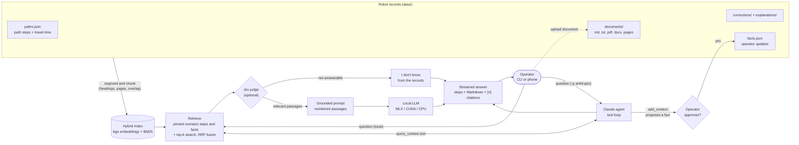

# HCI: Robot, explain yourself

A forest robot picks one path among several. This project lets it explain why, in plain language, from its own
records: past paths, the operating manual, reports, past corrections and operator updates. It is a small RAG system,
local-first: everything runs on your machine with no key. Claude is an optional backend.




If the records do not contain the answer, the app says it does not know.

## Features

- Hybrid retrieval with `BAAI/bge-small-en-v1.5` embeddings and BM25, fused with reciprocal rank fusion. The current
  scenario's steps and facts are always in context, and other scenarios are never searched.
- Ingestion of Markdown, text, PDF, Word and Apple Pages files, split along headings and pages with overlap. A file
  is indexed again when it changes.
- An optional Jev judge. With `TYPESAFE_API_KEY` set, [Jev](https://docs.typesafe.ai) scores each retrieved passage
  and refuses questions the records cannot answer.
- Local generation on MLX (Apple Silicon), CUDA or CPU (`transformers`), picked in that order.
- A Claude agent mode (`-p anthropic`). Claude searches the records and proposes facts through tools, and a fact is
  saved only after the operator approves it.
- Streamed answers that show the current step, for example `Searching: "..."`.
- A phone web app with Markdown answers (tables, callouts, citation badges) and document upload. The page loads no
  CDN script (`marked` and DOMPurify are in `web/vendor/`) but needs `hci serve` running.
- A live metrics log and local dashboard: time to first token, inter-piece latency, tokens, Jev latency, tool
  calls and estimated cost per message and per conversation.
- Test cases written as JSON data and checked by pytest (retrieval) and `hci eval` (answers).

## Quick start

Requires [uv](https://github.com/astral-sh/uv) and Python 3.12.

```sh
uv sync
uv run hci -s 0 ask "In which order should I take the paths to finish first?"
uv run hci -s 0 chat                                   # follow-ups and slash commands
uv run hci -s 2 fact "Path Q is closed for maintenance"
uv run hci serve                                       # phone app, see below
uv run hci dashboard --open                            # metrics and costs, see below
```

The first run downloads the models. API keys go in `.env` (git-ignored); load it with `uv run --env-file .env hci ...`.

`-s` is the scenario index in `data/paths.json`, `-p` the provider (`mlx | cuda | cpu | anthropic`), `-m` the model.
These come before the sub-command.

The Anthropic SDK reads `ANTHROPIC_BASE_URL`. If a wrapper sets it, a direct key fails with 401, and `--env-file`
does not override it. Prefix the command with `ANTHROPIC_BASE_URL=https://api.anthropic.com`.

In `chat`, type `/` for a menu: `/fact <text>`, `/scenario [n]`, `/clear`, `/help`, `/exit`.

## Configuration

Every tunable is a field of `Settings` in `hci/config.py`, read from `HCI_<FIELD>`. That file has the full list.

| Variable | Default | Purpose |
| --- | --- | --- |
| `HCI_PROVIDER` | fastest local | `mlx`, `cuda`, `cpu`, `anthropic` |
| `HCI_MODEL` | `mlx-community/Qwen3-4B-4bit` (MLX), `Qwen/Qwen3-4B` (CUDA), `Qwen/Qwen3-0.6B` (CPU) | local generator |
| `HCI_CLAUDE_MODEL` | `claude-sonnet-5-5` | model in agent mode |
| `HCI_AGENT_EFFORT` | `medium` | Claude effort level |
| `HCI_EMBED_MODEL` | `BAAI/bge-small-en-v1.5` | embedder |
| `HCI_K` | `6` | passages retrieved per question |
| `HCI_JEV_KEEP`, `HCI_JEV_ANSWERABLE` | `0.5`, `0.3` | Jev thresholds |
| `HCI_TOKEN` | random per run | phone API token |
| `HCI_HOST`, `HCI_PORT` | `0.0.0.0`, `8000` | server bind |
| `HCI_DOCUMENTS_DIR` | `data/documents` | documents folder, read recursively |
| `HCI_CHUNK_WORDS`, `HCI_CHUNK_OVERLAP_WORDS` | `220`, `40` | document chunk size and overlap |
| `HCI_MAX_UPLOAD_MB` | `20` | largest phone upload |
| `HCI_METRICS_ENABLED`, `HCI_METRICS_FILE` | `true`, `logs/metrics.jsonl` | metrics log |
| `HCI_DASHBOARD_HOST`, `HCI_DASHBOARD_PORT` | `127.0.0.1`, `8790` | standalone dashboard bind |
| `HCI_JEV_PRICE_INPUT_PER_MTOK`, `HCI_JEV_PRICE_OUTPUT_PER_MTOK` | `0.042`, `0` | Jev prices for cost estimates |
| `ANTHROPIC_API_KEY` | none | enables `-p anthropic` |
| `TYPESAFE_API_KEY` | none | enables the Jev judge |

## Phone app

```sh
uv run hci serve    # prints http://<lan-ip>:8000/#<token>
```

Open the link on a phone on the same Wi-Fi, then Share, Add to Home Screen. For each question you choose where
generation runs: on the machine running `hci serve` (nothing leaves your network), or on Claude (`anthropic`, listed
only when `ANTHROPIC_API_KEY` is set; the key stays on the server). Answers render as Markdown, sanitized with DOMPurify;
`marked` and DOMPurify are pinned in `web/vendor/`. Facts proposed by Claude appear with Approve / Reject buttons.
One local generation runs at a time.

## Documents

Drop files into `data/documents/` (subfolders included), or upload them from the phone with the Add document button.
A file that fails to parse is skipped with a warning and never breaks the index.

| Format | Sections | Paragraphs |
| --- | --- | --- |
| `.md` | `#` headings; the heading path is the section title | blank lines |
| `.docx` | `Title` and `Heading <n>` styles | one per paragraph and table row |
| `.pdf` | one per page | blank lines in the extracted text |
| `.txt` | none | blank lines |
| `.pages` | exported to PDF, then as PDF | as PDF |

Within a section, sentences are packed into chunks of at most `HCI_CHUNK_WORDS` words with `HCI_CHUNK_OVERLAP_WORDS`
of overlap. A chunk never spans two sections, and starts with its file name and section or page so answers can cite it.
`.pages` export needs macOS with Pages installed (`osascript`); elsewhere export to PDF or DOCX first.

Uploads (`POST /api/documents`) go to `data/documents/uploads/`. Limits: 401 without the token, 411 without
`Content-Length`, 413 above `HCI_MAX_UPLOAD_MB`, 415 for unsupported types, 422 for files with no extractable text, 500 when the file cannot be saved.
`GET /api/documents` lists documents with chunk counts. Size guards: `HCI_MAX_DOCX_EXPANDED_MB`,
`HCI_MAX_PDF_PAGES`, `HCI_MAX_DOCUMENT_CHARS`, `HCI_PAGES_EXPORT_TIMEOUT`.

Other records: `data/paths.json` (one chunk per path step, with travel time `t = d / v`), `data/corrections/*.md`
(past mistakes with the expected answer), `data/explanations/`, and `data/facts.json` (operator facts, git-ignored).
The index is rebuilt in memory at startup and whenever these files change.

## Agent mode

With `-p anthropic`, Claude works on the records through three tools: `query_context` (search the records),
`add_context` (propose a new fact) and `list_scenarios`. A proposed fact is saved only if the operator approves it:
the CLI asks `[y/N]` and the phone shows Approve / Reject. Local models use the fixed pipeline, because they are too small to
use tools reliably. A Claude failure (bad key, rate limit, network) ends the stream with a `Claude request failed` step and a
message saying what to fix.

## Metrics and dashboard

Every answer (`hci ask`, `hci chat`, the phone, `hci eval`) appends events to `logs/metrics.jsonl` (git-ignored), one
JSON object per line. Each line has `kind`, `ts` (epoch seconds), `source` (`cli`, `server`, `eval`), a
`request_id` that ties together the events of one answer, and a `conversation_id`: one per `hci chat` session (or
`hci ask` call), one per phone conversation (the page makes a random id, New conversation starts another; it is
sent as `conversation_id` in `/api/ask`), one per `hci eval` run.

| `kind` | Fields |
| --- | --- |
| `request` | provider, model, scenario, `question_chars`, `ttft_ms` (first answer text, steps excluded), `total_ms`, `queue_ms` (wait for the local generation lock, server), `ipl_mean_ms` / `ipl_p50_ms` / `ipl_p95_ms` / `ipl_max_ms` (inter-piece latency: gaps between streamed text pieces within one model turn; a piece is a word, a delta or a chunk depending on the backend, not a token), `output_pieces`, `output_tokens`, `tokens_per_s`, `input_tokens`, Claude `cache_creation_input_tokens` / `cache_read_input_tokens`, `model_ms` / `tool_ms` (Claude), `stop_reason`, `refusal`, `fallback_model`, `error` (class name), `cost_usd`, `cost` (by component), `price_unknown` |
| `retrieval` | `latency_ms` (Jev included), `k`, `chunks`, `pinned`, `judged`, `answerable` |
| `jev` | `latency_ms`, `network_ms` (httpx `elapsed`), `questions`, `passages_kept` / `passages_total`, `answerable_p`, Jev `input_tokens` / `output_tokens`, `model`, `fallback`, `error`, `cost_usd`, `price_unknown` |
| `tool` | agent tool name, `duration_ms`, `ok`, `result_chars`, `passages` (for `query_context`) |
| `model_turn` | one Claude turn: `duration_ms` (request to final message, tools excluded), usage tokens, `stop_reason`, `fallback_model`, `cost_usd`, `cost`, `price_unknown` |

Token counts are the model's own: MLX `stream_generate` responses, the HF tokenizer on the generated text, Claude's
`usage` summed over turns (thinking and tool calls included). `tokens_per_s` divides by the text streaming span for
local models and by `model_ms` for Claude, whose final text can arrive in one burst. Eval events use source `eval`,
so runs can be compared; the JSON report of `hci eval` is unchanged.

Costs are estimates: list prices applied to the usage the APIs report (no discounts, no batch rates). Each
Claude turn is priced by the model that answered (`response.model`, the fallback model when the server fell back),
input, output, cache write (1.25 x input, 5-minute cache) and cache read apart; a request sums its turns and its Jev
calls. Prices live in `MODEL_PRICES` in `hci/constants.py`, in USD per million tokens, with the date they were copied
(`PRICES_DATE`). A model or a component that is not listed is never guessed: its cost is `null` and
`price_unknown` is set (the request's cost then covers the priced parts only). Local models cost 0. Jev costs
$0.042 per million input tokens, and its output tokens are free of charge (TypeSafe, October 2026); override with
`HCI_JEV_PRICE_INPUT_PER_MTOK` and `HCI_JEV_PRICE_OUTPUT_PER_MTOK`. Unsetting either price makes the Jev cost `null`
and the dashboard says "Jev price not set".

The question text is not logged, only its length (`HCI_METRICS_LOG_QUESTIONS=true` adds it). Document
contents, tool inputs and results, API keys and the token are never logged. `HCI_METRICS_ENABLED=false` turns it off.
The file rotates to `metrics.jsonl.1` at `HCI_METRICS_MAX_MB` (default 10); one backup is kept.

The dashboard polls the log every 3 s: TTFT over time and its distribution per model, inter-piece latency p50/p95,
tokens/s, Claude tokens per request and totals, Jev latency (total and network) and tokens, retrieval latency, tool
calls, errors and fallbacks, and the last requests. Cost: today, last 7 days and the whole log (current file plus its
backup), average per answer, Anthropic and Jev totals, cumulative cost per model, the share of each component, cost
per answer, and conversations sorted by cost (click one to see its messages). Chart.js 4.5.0 is vendored in `web/vendor/`, so the dashboard needs no internet access.

```sh
uv run hci dashboard --open   # light server on http://127.0.0.1:8790/dashboard: no model, embedder or RAG loaded
```

It reads only the JSONL file, so it can run while nothing else does, and starts in about 0.3 s. On `127.0.0.1` (the
default, `HCI_DASHBOARD_HOST`) no token is needed, and only a loopback `Host` (`127.0.0.1`, `localhost`, `[::1]`) is
answered, so a web page cannot read it through DNS rebinding. On any other address `/api/metrics` needs the API
token; the printed link carries it on a terminal, never in a log. `hci serve` also serves `/dashboard`; its `/api/metrics` needs the token (link printed at startup).
`GET /api/metrics?since=<ts>&limit=<n>` returns the events.

Keep it always on (macOS): `uv run hci dashboard --install` writes the LaunchAgent
`~/Library/LaunchAgents/io.github.vlor999.hci-dashboard.plist` (runs the venv's `hci-dashboard` at login, restarts it,
logs to `logs/dashboard.log`) and loads it, retrying once if launchd refuses; it exits non-zero on failure. For a
non-loopback `HCI_DASHBOARD_HOST`, set `HCI_TOKEN` first: it is written into the plist (owner-only), so the token
stays the same across restarts; without it `--install` refuses. `--status` says whether it runs, `--uninstall` stops and removes it. On
Linux, `--install` prints the equivalent systemd user unit and the commands to enable it.

Plot from the JSONL without the dashboard:

```sh
jq -r 'select(.kind=="request") | [.ts, .provider, .ttft_ms, .tokens_per_s] | @tsv' logs/metrics.jsonl
uv run --with pandas python -c "import pandas as pd; d = pd.read_json('logs/metrics.jsonl', lines=True); print(d[d.kind == 'request'].groupby('model').ttft_ms.describe())"
```

## Evaluation

```sh
make check-all                # format, lint, ty, pytest (unit tests + every JSON case)
uv run hci eval               # cases end to end with the LLM: JSON report of quality and latency
uv run hci eval --no-answers  # retrieval only, no LLM
uv run hci eval --jev         # filter retrieval with the Jev judge (paid, needs TYPESAFE_API_KEY)
uv run hci -p anthropic eval  # same, on Claude
```

Without `--jev`, eval never calls Jev, even when the key is set; `ask`, `chat` and `serve` do use it.

Each file in `tests/cases/` is a JSON list of cases. The format is defined in `tests/cases/schema.json`, and pytest
validates every file against it. A case gives a question, an optional scenario, history and facts, and what to expect:
chunk ids that must or must not be in the context (pytest checks that each one names an existing file and a real
chunk), chunks that must come first, and words the answer must all contain, at least one of
(`answer_contains_any`), or must not contain. `unanswerable` marks a question the records do not answer: the answer
must refuse (it contains one of the refusal phrases of `hci/constants.py` and none of `answer_excludes`, which always
wins). With `--jev`, such a case passes retrieval when Jev refuses rather than on the pinned chunks, so a pinning
regression on it shows only in runs without the judge; when Jev refuses, the streamed `NOT_FOUND` is not scored as an
answer, so one Jev decision counts once. `xfail` marks a known weakness, and the case still runs.

Author run of `hci eval` on an M4 Pro, 2026-10-23 at `f2c06c9` (45 cases, 21 with answer checks; with `--jev` the 4 out-of-scope
cases Jev refused are scored on retrieval only, so 17 answers are checked):

| Metric | Qwen3-4B (MLX, default) | Claude (`-p anthropic`) | Claude + Jev (`-p anthropic eval --jev`) |
| --- | --- | --- | --- |
| Retrieval pass rate | 84 % (7 paraphrase misses marked `xfail`) | 84 % | 84 % |
| Recall of expected chunks | 74 % | 74 % | 74 % |
| Answer pass rate | 95 % | 100 % | 100 % |
| Retrieval latency (p50) | 7 ms | 7 ms | 246 ms |
| First token (p50) | 1.5 s | 4.6 s | 5.0 s |
| Generation | 84 tokens/s | streamed in chunks | streamed in chunks |

Gemma 4 E4B (`mlx-community/gemma-4-e4b-it-4bit`) was tested and not kept: same retrieval, 81 % answers (before the Markdown prompt), 0.8 s first token,
67 tokens/s.

## Development

| Command | Purpose |
| --- | --- |
| `make install` | `uv sync` |
| `make format-fix`, `make lint-fix` | apply ruff formatting and fixes |
| `make check-all` | `ruff format --check`, `ruff check`, `ty check`, `pytest` |
| `make eval` | `hci eval` (needs an LLM, not in `check-all`) |

All execution goes through `uv`. Unit tests mirror the modules (`tests/test_<module>.py`) and mock Anthropic, Jev and
model loading; only the case runner uses the real embedder. CI runs `uv sync --locked` then `make check-all`.
Conventions for contributors and agents are in `CLAUDE.md` and `.agents/rules/`.

## Security notes

- The `HCI_TOKEN` holder is the operator: they can upload documents, which enter the grounding corpus without review,
  and approve facts.
- `hci serve` binds `0.0.0.0` by default, so the whole LAN can reach it. Use `--host 127.0.0.1` for local only.
- The token is random per process unless `HCI_TOKEN` is set, so a Home Screen link stops working after a restart.
  Set `HCI_TOKEN` to keep it stable. The page stores the token in the browser's `localStorage`.
- The server speaks plain HTTP. On a LAN the token and answers travel unencrypted: use a trusted network or a TLS
  reverse proxy.
- API keys stay on the server and never reach the web page.

## License

[MIT](LICENSE)
